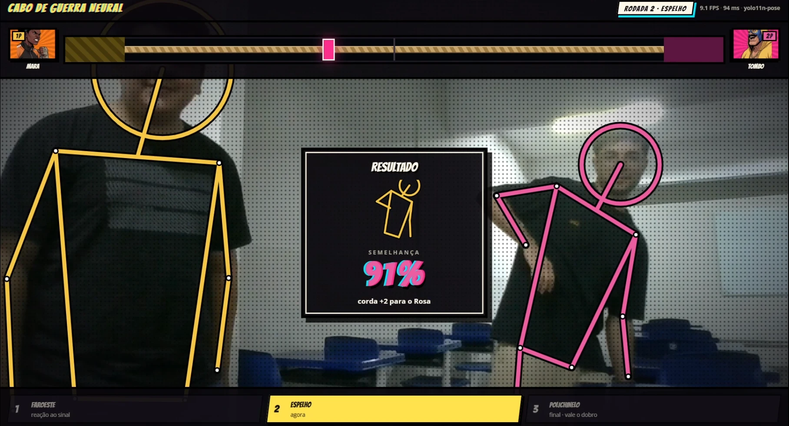

# Cabo de Guerra Neural

Jogo em que **duas pessoas disputam um cabo de guerra virtual usando o próprio
corpo** diante de uma webcam. Cada rodada vencida puxa a corda para o lado do
vencedor; vence quem levar a corda até a sua ponta.

Trabalho da disciplina de redes neurais para o **5º Workshop de Trabalhos de
Inteligência Artificial** — UniRV / FASOFT.



## As redes neurais

| Rede | Papel |
|---|---|
| **YOLO11-Pose** (pré-treinada no COCO) | detecta os dois jogadores e os 17 pontos do corpo de cada um |
| **Classificador de poses (MLP)** | treinado pela equipe com gravações próprias; reconhece as poses que decidem as rodadas Faroeste e Polichinelo |

A pontuação da rodada **Espelho** é calculada a partir dos pontos devolvidos
pela YOLO-Pose: o sistema compara os ângulos de 14 segmentos do corpo (braços,
pernas, tronco, ombros, quadril e cabeça), com pesos diferentes por segmento.

## As três rodadas

1. **Faroeste** — ao sinal na tela, quem fizer a pose de saque primeiro vence.
2. **Espelho** — um jogador faz uma pose, o outro copia. A semelhança define
   quantos passos a corda anda. Depois os papéis trocam.
3. **Polichinelo** — 10 segundos; cada repetição validada pela rede puxa a corda.
   Vale o dobro.

> **Estado:** a rodada Espelho está jogável. Faroeste, Polichinelo e a MLP estão
> em desenvolvimento.

## Como rodar

```powershell
py -3.12 -m pip install -r requirements.txt
py -3.12 jogo\servidor.py
```

Abra **http://localhost:8000** e permita o acesso à câmera.

O modelo `jogo/yolo11n-pose.pt` e as fontes já estão no repositório, então o
jogo **roda sem internet**.

Instruções completas, teclas e ajustes: [COMO_RODAR.md](COMO_RODAR.md).

## Como funciona

```
NAVEGADOR                                 SERVIDOR (Python)
  webcam  ──► exibe o vídeo a 30 fps
          └─► JPEG 480 px + timestamp ───► YOLO11-Pose ──► 17 pontos × 2 pessoas
              desenha esqueleto,   ◄─── JSON (pontos + estado) ◄── regras do jogo
              corda e HUD
```

O vídeo **não** trafega pela rede: fica no navegador. Só os pontos e o estado
da partida vão e voltam, por WebSocket. Por isso a imagem continua fluida mesmo
com a inferência a 8–10 quadros por segundo.

**Nenhuma imagem é gravada** em momento algum.

## Estrutura

```
jogo/      servidor Python: YOLO-Pose, regras da partida e o modelo .pt
web/       interface: seleção de lutador, partida, esqueleto e HUD
banner/    gerador do PDF do banner do workshop
```

## Licenças

Este projeto usa **Ultralytics YOLO11**, distribuído sob **AGPL-3.0**. Como a
AGPL alcança o uso em rede, **este repositório é público** e o código completo
fica disponível a quem usar a aplicação. Veja [LICENCAS.md](LICENCAS.md) para as
licenças de terceiros (modelo, fontes e arte).
